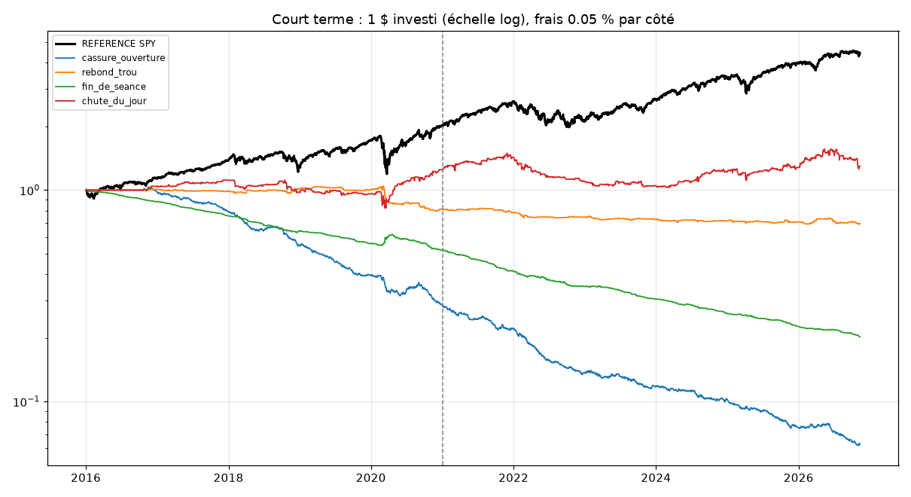

# Labo court terme (journée et 1 jour)

Généré le 2026-11-12. Données : Alpaca, bougies de 15 minutes ajustées, séance normale, depuis 2016.

Frais : 0.05 % par achat et par vente (grandes valeurs très échangées), test de résistance à 0,10 %. Réglage 2016-2020, vérification 2021 à aujourd'hui. Critères fixés avant le test.

## Période : tout

| Stratégie | Rendement / an | Pire baisse | Sharpe | Trades / mois | Réussite | Trade moyen | Facteur profit |
|---|---|---|---|---|---|---|---|
| REFERENCE (acheter SPY et garder) | +14.8 % | -33.8 % | 0.87 | - | - | - | - |
| cassure_ouverture | -22.5 % | -94.0 % | -2.80 | 102.8 | 39.4 % | -0.1 % | 0.75 |
| rebond_trou | -3.3 % | -33.9 % | -0.68 | 7.8 | 42.2 % | -0.2 % | 0.76 |
| fin_de_seance | -13.7 % | -79.8 % | -4.37 | 23.4 | 26.1 % | -0.1 % | 0.31 |
| chute_du_jour | +2.4 % | -31.1 % | 0.25 | 20.4 | 51.3 % | +0.1 % | 1.07 |

## Période : reglage (2016-2020)

| Stratégie | Rendement / an | Pire baisse | Sharpe | Trades / mois | Réussite | Trade moyen | Facteur profit |
|---|---|---|---|---|---|---|---|
| REFERENCE (acheter SPY et garder) | +15.3 % | -33.8 % | 0.84 | - | - | - | - |
| cassure_ouverture | -22.2 % | -72.2 % | -2.87 | 103.0 | 37.8 % | -0.1 % | 0.72 |
| rebond_trou | -4.1 % | -23.7 % | -0.71 | 7.5 | 38.5 % | -0.3 % | 0.71 |
| fin_de_seance | -12.3 % | -48.1 % | -3.44 | 23.3 | 25.2 % | -0.1 % | 0.36 |
| chute_du_jour | +4.6 % | -26.4 % | 0.42 | 17.1 | 53.6 % | +0.2 % | 1.15 |

## Période : verification (2021-auj.)

| Stratégie | Rendement / an | Pire baisse | Sharpe | Trades / mois | Réussite | Trade moyen | Facteur profit |
|---|---|---|---|---|---|---|---|
| REFERENCE (acheter SPY et garder) | +14.7 % | -24.5 % | 0.91 | - | - | - | - |
| cassure_ouverture | -22.6 % | -78.0 % | -2.71 | 102.9 | 40.6 % | -0.1 % | 0.77 |
| rebond_trou | -2.7 % | -15.9 % | -0.66 | 8.0 | 44.8 % | -0.1 % | 0.80 |
| fin_de_seance | -14.9 % | -61.1 % | -5.46 | 23.6 | 26.9 % | -0.1 % | 0.28 |
| chute_du_jour | +0.6 % | -31.1 % | 0.11 | 22.9 | 50.1 % | +0.0 % | 1.03 |

## Verdict (critères fixés à l'avance)

**cassure_ouverture : 1 / 7 critères**
- ❌ Gagnante sur la vérification (2021-2026), frais compris
- ❌ Gagnante aussi sur le réglage (2016-2020)
- ❌ Reste gagnante avec des frais doublés (0,10 % par côté)
- ✅ Au moins 200 trades sur la vérification
- ❌ Facteur de profit d'au moins 1,2
- ❌ Sharpe meilleur que la référence
- ❌ Pire baisse moins grave que -30 %

**rebond_trou : 2 / 7 critères**
- ❌ Gagnante sur la vérification (2021-2026), frais compris
- ❌ Gagnante aussi sur le réglage (2016-2020)
- ❌ Reste gagnante avec des frais doublés (0,10 % par côté)
- ✅ Au moins 200 trades sur la vérification
- ❌ Facteur de profit d'au moins 1,2
- ❌ Sharpe meilleur que la référence
- ✅ Pire baisse moins grave que -30 %

**fin_de_seance : 1 / 7 critères**
- ❌ Gagnante sur la vérification (2021-2026), frais compris
- ❌ Gagnante aussi sur le réglage (2016-2020)
- ❌ Reste gagnante avec des frais doublés (0,10 % par côté)
- ✅ Au moins 200 trades sur la vérification
- ❌ Facteur de profit d'au moins 1,2
- ❌ Sharpe meilleur que la référence
- ❌ Pire baisse moins grave que -30 %

**chute_du_jour : 3 / 7 critères**
- ✅ Gagnante sur la vérification (2021-2026), frais compris
- ✅ Gagnante aussi sur le réglage (2016-2020)
- ❌ Reste gagnante avec des frais doublés (0,10 % par côté)
- ✅ Au moins 200 trades sur la vérification
- ❌ Facteur de profit d'au moins 1,2
- ❌ Sharpe meilleur que la référence
- ❌ Pire baisse moins grave que -30 %

## Pour information : rendement par an selon les frais (vérification 2021-auj.)

Ce tableau n'est PAS un critère : il montre s'il existe un avantage avant frais, et combien les frais le mangent.

| Stratégie | 0.00 % | 0.01 % | 0.02 % | 0.05 % | 0.10 % |
|---|---|---|---|---|---|
| cassure_ouverture | -0.8 % | -5.6 % | -10.2 % | -22.6 % | -39.5 % |
| rebond_trou | -0.8 % | -1.2 % | -1.6 % | -2.7 % | -4.5 % |
| fin_de_seance | -2.0 % | -4.7 % | -7.4 % | -14.9 % | -26.2 % |
| chute_du_jour | +6.3 % | +5.2 % | +4.0 % | +0.6 % | -4.8 % |

