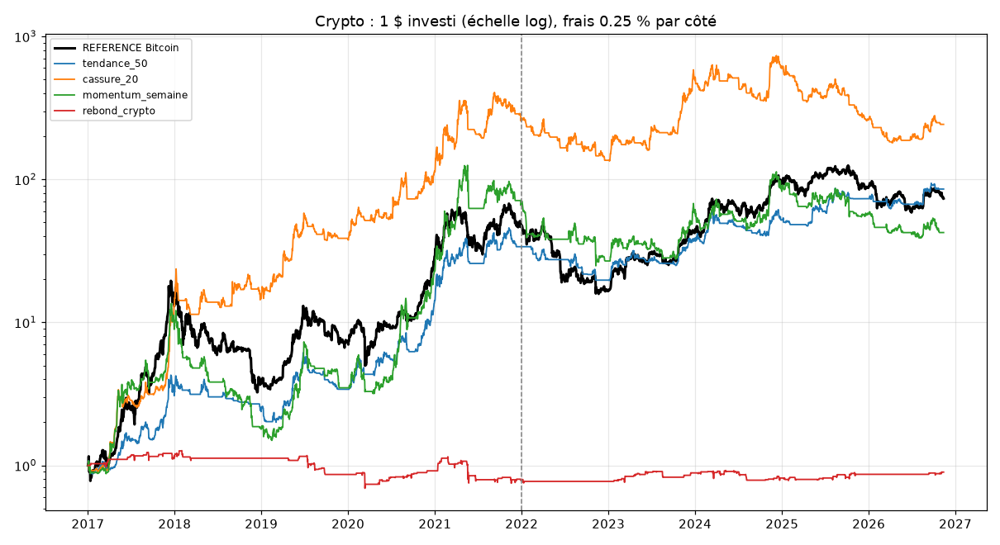

# Labo crypto

Généré le 2026-11-12. Données : Yahoo Finance, cours journaliers en dollars.

Frais : 0.25 % par achat et par vente, test de résistance au double. Réglage 2017-2021, vérification 2022 à aujourd'hui. Décision à minuit (UTC), achat ou vente à l'ouverture suivante. Critères fixés avant le test. Attention : seules les cryptos qui existent encore sont testées (biais du survivant).

## Les stratégies

- **tendance_50** : Bitcoin et Ethereum : détenir quand la clôture est au-dessus de la moyenne 50 jours, sinon rester en dollars
- **cassure_20** : Panier : achat si clôture = plus haut des 20 derniers jours ; vente si clôture < plus bas des 10 jours précédents
- **momentum_semaine** : Panier, chaque dimanche : achat des 3 meilleures sur 4 semaines (au-dessus de la moyenne 50 j) ; vente un dimanche où la hausse sur 4 semaines devient négative ou le cours passe sous la MM50
- **rebond_crypto** : Bitcoin et Ethereum : achat si clôture > moyenne 200 j ET RSI(2) < 10 ; vente si clôture > moyenne 5 j, ou après 5 jours

## Période : tout

| Stratégie | Rendement / an | Pire baisse | Sharpe | Trades / mois | Réussite | Trade moyen | Jours moyens | Temps investi |
|---|---|---|---|---|---|---|---|---|
| REFERENCE (acheter du Bitcoin et garder) | +54.6 % | -83.4 % | 0.99 | - | - | - | - | 100.0 % |
| tendance_50 | +57.0 % | -57.2 % | 1.21 | 1.5 | 24.7 % | +9.3 % | 20.8 | 51.2 % |
| cassure_20 | +74.4 % | -75.4 % | 1.21 | 2.8 | 40.9 % | +9.3 % | 17.3 | 53.2 % |
| momentum_semaine | +46.2 % | -89.0 % | 0.89 | 1.9 | 38.5 % | +12.7 % | 30.2 | 62.1 % |
| rebond_crypto | -1.1 % | -45.5 % | 0.05 | 1.4 | 65.1 % | +0.1 % | 3.3 | 7.7 % |

## Période : reglage (2017-2021)

| Stratégie | Rendement / an | Pire baisse | Sharpe | Trades / mois | Réussite | Trade moyen | Jours moyens | Temps investi |
|---|---|---|---|---|---|---|---|---|
| REFERENCE (acheter du Bitcoin et garder) | +115.4 % | -83.4 % | 1.36 | - | - | - | - | 100.0 % |
| tendance_50 | +102.2 % | -53.2 % | 1.57 | 1.4 | 28.7 % | +16.9 % | 23.1 | 52.5 % |
| cassure_20 | +204.8 % | -51.8 % | 1.90 | 2.5 | 47.4 % | +18.0 % | 18.8 | 53.9 % |
| momentum_semaine | +133.0 % | -89.0 % | 1.42 | 1.6 | 43.5 % | +29.4 % | 35.7 | 62.5 % |
| rebond_crypto | -4.7 % | -45.5 % | -0.05 | 1.4 | 64.3 % | -0.2 % | 3.3 | 7.6 % |

## Période : verification (2022-auj.)

| Stratégie | Rendement / an | Pire baisse | Sharpe | Trades / mois | Réussite | Trade moyen | Jours moyens | Temps investi |
|---|---|---|---|---|---|---|---|---|
| REFERENCE (acheter du Bitcoin et garder) | +9.2 % | -66.9 % | 0.43 | - | - | - | - | 100.0 % |
| tendance_50 | +21.0 % | -42.2 % | 0.72 | 1.7 | 21.3 % | +2.8 % | 18.7 | 49.8 % |
| cassure_20 | -2.0 % | -75.4 % | 0.20 | 3.0 | 35.2 % | +1.7 % | 16.0 | 52.6 % |
| momentum_semaine | -9.9 % | -65.6 % | 0.08 | 2.2 | 34.9 % | +0.5 % | 26.1 | 61.7 % |
| rebond_crypto | +2.5 % | -15.1 % | 0.25 | 1.5 | 65.9 % | +0.3 % | 3.3 | 7.8 % |

## Verdict (critères fixés à l'avance)

**tendance_50 : 5 / 6 critères**
- ✅ Gagnante sur la vérification (2022-auj.), frais compris
- ✅ Gagnante aussi sur le réglage (2017-2021)
- ✅ Reste gagnante avec des frais doublés (0,50 % par côté)
- ✅ Au moins 30 trades sur la vérification
- ✅ Sharpe meilleur que garder du Bitcoin
- ❌ Pire baisse au moins 2 fois moins grave que celle du Bitcoin

**cassure_20 : 2 / 6 critères**
- ❌ Gagnante sur la vérification (2022-auj.), frais compris
- ✅ Gagnante aussi sur le réglage (2017-2021)
- ❌ Reste gagnante avec des frais doublés (0,50 % par côté)
- ✅ Au moins 30 trades sur la vérification
- ❌ Sharpe meilleur que garder du Bitcoin
- ❌ Pire baisse au moins 2 fois moins grave que celle du Bitcoin

**momentum_semaine : 2 / 6 critères**
- ❌ Gagnante sur la vérification (2022-auj.), frais compris
- ✅ Gagnante aussi sur le réglage (2017-2021)
- ❌ Reste gagnante avec des frais doublés (0,50 % par côté)
- ✅ Au moins 30 trades sur la vérification
- ❌ Sharpe meilleur que garder du Bitcoin
- ❌ Pire baisse au moins 2 fois moins grave que celle du Bitcoin

**rebond_crypto : 3 / 6 critères**
- ✅ Gagnante sur la vérification (2022-auj.), frais compris
- ❌ Gagnante aussi sur le réglage (2017-2021)
- ❌ Reste gagnante avec des frais doublés (0,50 % par côté)
- ✅ Au moins 30 trades sur la vérification
- ❌ Sharpe meilleur que garder du Bitcoin
- ✅ Pire baisse au moins 2 fois moins grave que celle du Bitcoin

