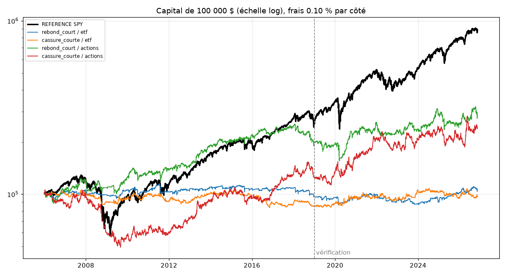

# Résultats du backtest

Généré le 2026-11-11. Données : Yahoo Finance, cours journaliers ajustés.

Règles de simulation : décision le soir à la clôture, ordre à l'ouverture du lendemain, 5 positions au plus (environ 1/5 du capital chacune), frais 0.10 % par achat et par vente, actions entières, pas de levier.

## Période : tout

| Stratégie | Rendement / an | Pire baisse | Sharpe | Trades / mois | Réussite | Trade moyen | Jours moyens | Facteur profit | Investi |
|---|---|---|---|---|---|---|---|---|---|
| REFERENCE (acheter SPY et garder) | +11.0 % | -55.2 % | 0.64 | - | - | - | - | - | 100.0 % |
| rebond_court / etf | +0.2 % | -23.7 % | 0.07 | 8.2 | 60.2 % | +0.0 % | 3.3 | 1.02 | 25.4 % |
| cassure_courte / etf | -0.1 % | -21.3 % | 0.03 | 9.3 | 43.6 % | +0.0 % | 6.9 | 0.99 | 61.2 % |
| rebond_court / actions | +5.1 % | -38.7 % | 0.41 | 17.4 | 60.5 % | +0.1 % | 3.3 | 1.11 | 54.4 % |
| cassure_courte / actions | +4.3 % | -53.4 % | 0.33 | 12.8 | 42.9 % | +0.2 % | 7.0 | 1.09 | 85.4 % |

## Période : reglage (2006-2018)

| Stratégie | Rendement / an | Pire baisse | Sharpe | Trades / mois | Réussite | Trade moyen | Jours moyens | Facteur profit | Investi |
|---|---|---|---|---|---|---|---|---|---|
| REFERENCE (acheter SPY et garder) | +7.5 % | -55.2 % | 0.48 | - | - | - | - | - | 100.0 % |
| rebond_court / etf | -0.3 % | -15.3 % | -0.00 | 7.9 | 59.4 % | -0.0 % | 3.3 | 0.98 | 24.6 % |
| cassure_courte / etf | -1.2 % | -21.3 % | -0.11 | 9.0 | 43.0 % | -0.0 % | 7.0 | 0.94 | 59.3 % |
| rebond_court / actions | +5.5 % | -25.1 % | 0.47 | 16.7 | 60.2 % | +0.2 % | 3.3 | 1.13 | 52.3 % |
| cassure_courte / actions | +1.8 % | -53.4 % | 0.19 | 12.4 | 44.1 % | +0.1 % | 7.1 | 1.05 | 83.7 % |

## Période : verification (2019-auj.)

| Stratégie | Rendement / an | Pire baisse | Sharpe | Trades / mois | Réussite | Trade moyen | Jours moyens | Facteur profit | Investi |
|---|---|---|---|---|---|---|---|---|---|
| REFERENCE (acheter SPY et garder) | +16.9 % | -33.7 % | 0.91 | - | - | - | - | - | 100.0 % |
| rebond_court / etf | +1.1 % | -13.7 % | 0.18 | 8.7 | 61.3 % | +0.1 % | 3.2 | 1.07 | 26.7 % |
| cassure_courte / etf | +1.6 % | -12.8 % | 0.22 | 9.7 | 44.5 % | +0.1 % | 6.9 | 1.06 | 64.2 % |
| rebond_court / actions | +4.6 % | -24.6 % | 0.35 | 18.5 | 61.0 % | +0.1 % | 3.3 | 1.09 | 57.9 % |
| cassure_courte / actions | +8.7 % | -24.4 % | 0.53 | 13.4 | 41.1 % | +0.3 % | 6.9 | 1.12 | 88.1 % |

## Test de résistance : frais doublés, période de vérification

| Stratégie | Rendement / an | Sharpe | Facteur profit |
|---|---|---|---|
| rebond_court / etf | -3.0 % | -0.37 | 0.81 |
| cassure_courte / etf | -3.0 % | -0.27 | 0.89 |
| rebond_court / actions | -4.3 % | -0.17 | 0.92 |
| cassure_courte / actions | +2.1 % | 0.20 | 1.03 |

## Verdict (critères fixés à l'avance, période de vérification)

**rebond_court / etf : ne passe pas**
- ❌ Sharpe meilleur que la référence (plus de gain pour le risque pris)
- ✅ Pire baisse moins grave que -30 %
- ❌ Facteur de profit d'au moins 1,2 (gains / pertes)
- ✅ Au moins 100 trades (sinon c'est peut-être de la chance)

**cassure_courte / etf : ne passe pas**
- ❌ Sharpe meilleur que la référence (plus de gain pour le risque pris)
- ✅ Pire baisse moins grave que -30 %
- ❌ Facteur de profit d'au moins 1,2 (gains / pertes)
- ✅ Au moins 100 trades (sinon c'est peut-être de la chance)

**rebond_court / actions : ne passe pas**
- ❌ Sharpe meilleur que la référence (plus de gain pour le risque pris)
- ✅ Pire baisse moins grave que -30 %
- ❌ Facteur de profit d'au moins 1,2 (gains / pertes)
- ✅ Au moins 100 trades (sinon c'est peut-être de la chance)

**cassure_courte / actions : ne passe pas**
- ❌ Sharpe meilleur que la référence (plus de gain pour le risque pris)
- ✅ Pire baisse moins grave que -30 %
- ❌ Facteur de profit d'au moins 1,2 (gains / pertes)
- ✅ Au moins 100 trades (sinon c'est peut-être de la chance)

Un backtest réussi n'est pas une promesse : c'est le droit de passer à la simulation en temps réel (compte fictif), qui seule dira si la stratégie tient.
