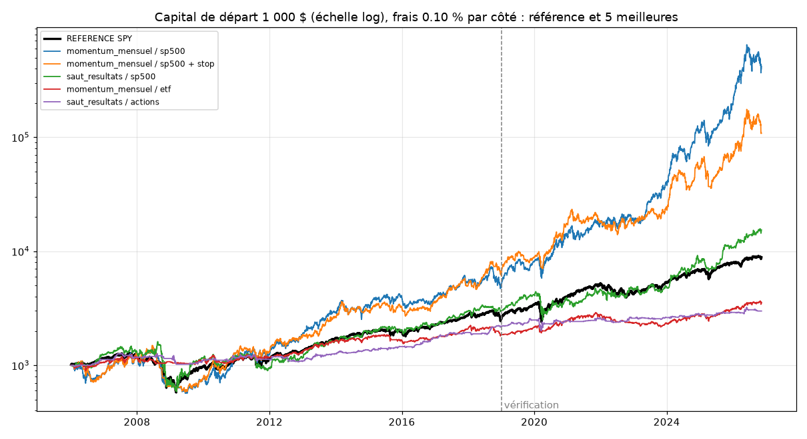

# Résultats du backtest

Généré le 2026-11-12. Données : Yahoo Finance, cours journaliers ajustés.

Règles de simulation : capital de départ 1 000 $, décision le soir à la clôture, ordre à l'ouverture du lendemain, 5 positions au plus (environ 1/5 du capital chacune), frais 0.10 % par achat et par vente, fractions d'actions, pas de levier.

Variantes « + stop » : stop de sécurité à 3 x ATR(14) sous le prix d'achat, actif dès le lendemain de l'achat ; les sorties de la stratégie restent en place.

## Classement (période de vérification, 2019 à aujourd'hui)

| Stratégie | Critères réussis | Rendement / an | Pire baisse | Sharpe | Trades / mois |
|---|---|---|---|---|---|
| REFERENCE (acheter SPY et garder) | - | +16.9 % | -33.7 % | 0.91 | - |
| momentum_mensuel / sp500 | 5 / 6 | +75.8 % | -43.3 % | 1.50 | 5.0 |
| momentum_mensuel / sp500 + stop | 5 / 6 | +43.8 % | -47.2 % | 1.14 | 5.0 |
| saut_resultats / sp500 | 5 / 6 | +23.0 % | -43.6 % | 0.95 | 4.2 |
| momentum_mensuel / etf | 5 / 6 | +8.7 % | -25.3 % | 0.74 | 4.2 |
| saut_resultats / actions | 5 / 6 | +4.0 % | -22.2 % | 0.42 | 1.1 |
| saut_resultats / actions + stop | 5 / 6 | +3.1 % | -16.8 % | 0.40 | 1.1 |
| saut_resultats / sp500 + stop | 4 / 6 | +21.7 % | -36.5 % | 0.94 | 4.5 |
| momentum_mensuel / actions | 4 / 6 | +21.1 % | -35.3 % | 0.84 | 5.0 |
| saut_resultats / sp500_historique | 4 / 6 | +8.6 % | -41.9 % | 0.46 | 3.9 |
| momentum_mensuel / sp500_historique | 3 / 6 | +18.7 % | -48.6 % | 0.63 | 5.0 |
| saut_resultats / sp500_historique + stop | 3 / 6 | +7.6 % | -41.6 % | 0.44 | 4.2 |
| momentum_mensuel / actions + stop | 3 / 6 | +7.6 % | -32.8 % | 0.43 | 5.0 |
| rotation_etf / etf | 3 / 6 | +4.8 % | -31.8 % | 0.34 | 2.0 |
| momentum_mensuel / etf + stop | 3 / 6 | +2.7 % | -26.8 % | 0.30 | 4.4 |
| saut_resultats / etf | 2 / 6 | +0.6 % | -2.0 % | 0.46 | 0.1 |
| saut_resultats / etf + stop | 2 / 6 | +0.6 % | -2.0 % | 0.46 | 0.1 |
| momentum_mensuel / sp500_historique + stop | 2 / 6 | +6.1 % | -50.0 % | 0.35 | 5.0 |
| rotation_etf / etf + stop | 2 / 6 | +3.7 % | -35.9 % | 0.32 | 2.0 |
| cassure_courte / sp500_historique + stop | 1 / 6 | -0.6 % | -59.9 % | 0.09 | 13.9 |
| rebond_court / sp500_historique + stop | 1 / 6 | -0.4 % | -45.2 % | 0.08 | 28.9 |
| rebond_court / sp500_historique | 1 / 6 | -0.8 % | -48.1 % | 0.06 | 28.4 |
| cassure_courte / sp500_historique | 1 / 6 | -1.4 % | -61.6 % | 0.06 | 13.9 |
| nuit (SPY+QQQ) / indices | 1 / 6 | -32.5 % | -95.6 % | -2.84 | 41.9 |
| panique_vix / spy | 0 / 6 | -0.7 % | -30.0 % | -0.00 | 0.3 |
| panique_vix / spy + stop | 0 / 6 | -2.3 % | -37.6 % | -0.14 | 0.4 |

## Les règles de chaque stratégie

- **saut_resultats** : Achat si ouverture >= +3 % sur la veille, volume >= 3 fois la moyenne 50 jours et clôture >= ouverture ; revente au bout de 20 séances
- **panique_vix** : SPY : achat si le VIX clôture 30 % au-dessus de sa moyenne 20 jours ; vente quand il repasse sous sa moyenne 20 jours, ou au bout de 10 séances
- **momentum_mensuel** : Chaque fin de mois : acheter les 5 valeurs (> moyenne 200 j) qui ont le plus monté entre il y a 12 mois et il y a 1 mois ; revendre à la fin du mois suivant
- **rotation_etf** : ETF, chaque fin de mois : les 2 qui ont le plus monté sur 6 mois (si hausse > 0) ; sinon obligations US (TLT) ; revente à la fin du mois suivant
- **rebond_court** : Achat si clôture > moyenne 200 jours ET RSI(2) < 10 ; vente si clôture > moyenne 5 jours, ou après 5 jours
- **cassure_courte** : Achat si clôture = plus haute des 20 derniers jours ET > moyenne 200 jours ; vente si clôture < plus basse des 5 jours précédents, ou après 10 jours
- **nuit (SPY+QQQ)** : Achat de SPY et QQQ (moitié-moitié) à la clôture, revente à l'ouverture le lendemain, chaque jour

## Période : tout

| Stratégie | Rendement / an | Pire baisse | Sharpe | Trades / mois | Réussite | Trade moyen | Jours moyens | Facteur profit | Investi |
|---|---|---|---|---|---|---|---|---|---|
| REFERENCE (acheter SPY et garder) | +11.0 % | -55.2 % | 0.64 | - | - | - | - | - | 100.0 % |
| saut_resultats / etf | +0.3 % | -2.5 % | 0.22 | 0.0 | 100.0 % | +5.3 % | 20.0 | - | 0.4 % |
| saut_resultats / etf + stop | +0.3 % | -2.5 % | 0.22 | 0.0 | 100.0 % | +5.3 % | 20.0 | - | 0.4 % |
| saut_resultats / actions | +5.4 % | -22.2 % | 0.58 | 1.1 | 60.1 % | +2.1 % | 20.0 | 1.77 | 21.6 % |
| saut_resultats / actions + stop | +4.6 % | -18.8 % | 0.56 | 1.1 | 59.4 % | +1.8 % | 18.3 | 1.62 | 19.9 % |
| saut_resultats / sp500 | +14.0 % | -63.6 % | 0.66 | 4.3 | 55.8 % | +1.5 % | 20.0 | 1.69 | 82.0 % |
| saut_resultats / sp500 + stop | +8.4 % | -71.2 % | 0.46 | 4.7 | 52.6 % | +0.9 % | 17.7 | 1.39 | 79.0 % |
| panique_vix / spy | -0.8 % | -48.1 % | -0.02 | 0.3 | 60.9 % | -0.2 % | 7.7 | 0.81 | 9.4 % |
| panique_vix / spy + stop | -1.9 % | -57.2 % | -0.11 | 0.4 | 56.5 % | -0.4 % | 5.6 | 0.74 | 9.1 % |
| momentum_mensuel / etf | +6.3 % | -25.3 % | 0.55 | 4.2 | 58.6 % | +0.7 % | 21.0 | 1.48 | 83.3 % |
| momentum_mensuel / etf + stop | +1.4 % | -26.8 % | 0.18 | 4.3 | 51.8 % | +0.2 % | 16.5 | 1.08 | 68.0 % |
| momentum_mensuel / actions | +16.0 % | -46.9 % | 0.73 | 4.8 | 55.7 % | +1.5 % | 21.0 | 1.44 | 96.2 % |
| momentum_mensuel / actions + stop | +8.7 % | -46.4 % | 0.51 | 4.9 | 51.7 % | +0.9 % | 17.2 | 1.18 | 79.9 % |
| momentum_mensuel / sp500 | +33.6 % | -60.4 % | 0.99 | 5.0 | 56.7 % | +3.0 % | 21.0 | 1.95 | 98.4 % |
| momentum_mensuel / sp500 + stop | +25.3 % | -60.9 % | 0.89 | 5.0 | 53.8 % | +2.5 % | 17.2 | 1.46 | 82.1 % |
| rotation_etf / etf | +4.5 % | -40.2 % | 0.33 | 1.9 | 55.4 % | +0.5 % | 21.0 | 1.22 | 96.6 % |
| rotation_etf / etf + stop | +1.5 % | -35.9 % | 0.18 | 2.0 | 50.7 % | +0.2 % | 16.6 | 1.07 | 77.3 % |
| saut_resultats / sp500_historique | +10.3 % | -65.9 % | 0.48 | 3.9 | 55.2 % | +1.4 % | 20.0 | 1.30 | 74.4 % |
| saut_resultats / sp500_historique + stop | +7.4 % | -68.0 % | 0.39 | 4.2 | 53.2 % | +1.0 % | 17.8 | 1.18 | 71.1 % |
| momentum_mensuel / sp500_historique | +9.6 % | -57.5 % | 0.44 | 4.9 | 55.1 % | +1.1 % | 21.0 | 1.33 | 98.0 % |
| momentum_mensuel / sp500_historique + stop | +2.4 % | -54.8 % | 0.22 | 5.0 | 48.8 % | +0.5 % | 16.7 | 1.05 | 79.4 % |
| rebond_court / sp500_historique | -1.1 % | -52.2 % | 0.04 | 27.6 | 59.1 % | +0.0 % | 3.3 | 0.99 | 86.4 % |
| rebond_court / sp500_historique + stop | -2.8 % | -63.8 % | -0.05 | 28.0 | 58.9 % | -0.0 % | 3.2 | 0.97 | 85.0 % |
| cassure_courte / sp500_historique | -6.3 % | -88.0 % | -0.15 | 13.8 | 43.3 % | -0.1 % | 7.4 | 0.86 | 96.4 % |
| cassure_courte / sp500_historique + stop | -6.1 % | -87.8 % | -0.15 | 13.9 | 43.1 % | -0.1 % | 7.3 | 0.86 | 95.9 % |
| nuit (SPY+QQQ) / indices | -33.8 % | -100.0 % | -3.40 | 41.9 | 37.8 % | -0.2 % | 1.0 | 0.52 | 100.0 % |

## Période : reglage (2006-2018)

| Stratégie | Rendement / an | Pire baisse | Sharpe | Trades / mois | Réussite | Trade moyen | Jours moyens | Facteur profit | Investi |
|---|---|---|---|---|---|---|---|---|---|
| REFERENCE (acheter SPY et garder) | +7.5 % | -55.2 % | 0.48 | - | - | - | - | - | 100.0 % |
| saut_resultats / etf | +0.1 % | -2.5 % | 0.05 | 0.0 | 100.0 % | +1.7 % | 20.0 | - | 0.2 % |
| saut_resultats / etf + stop | +0.1 % | -2.5 % | 0.05 | 0.0 | 100.0 % | +1.7 % | 20.0 | - | 0.2 % |
| saut_resultats / actions | +6.3 % | -19.6 % | 0.70 | 1.2 | 61.3 % | +2.3 % | 20.0 | 2.06 | 22.3 % |
| saut_resultats / actions + stop | +5.6 % | -18.8 % | 0.66 | 1.2 | 60.8 % | +2.1 % | 18.6 | 1.83 | 20.8 % |
| saut_resultats / sp500 | +8.9 % | -63.6 % | 0.47 | 4.4 | 54.3 % | +1.1 % | 20.0 | 1.35 | 83.3 % |
| saut_resultats / sp500 + stop | +1.1 % | -71.2 % | 0.16 | 4.8 | 50.8 % | +0.3 % | 17.7 | 1.04 | 80.2 % |
| panique_vix / spy | -0.9 % | -41.3 % | -0.03 | 0.2 | 56.8 % | -0.2 % | 7.7 | 0.81 | 8.9 % |
| panique_vix / spy + stop | -1.6 % | -38.2 % | -0.09 | 0.3 | 53.1 % | -0.3 % | 5.6 | 0.78 | 8.6 % |
| momentum_mensuel / etf | +5.0 % | -19.4 % | 0.45 | 4.2 | 58.3 % | +0.6 % | 21.0 | 1.40 | 83.2 % |
| momentum_mensuel / etf + stop | +0.6 % | -26.5 % | 0.11 | 4.3 | 52.3 % | +0.1 % | 16.6 | 1.04 | 67.3 % |
| momentum_mensuel / actions | +13.2 % | -46.9 % | 0.66 | 4.8 | 57.7 % | +1.3 % | 21.0 | 1.48 | 94.3 % |
| momentum_mensuel / actions + stop | +9.3 % | -46.4 % | 0.58 | 4.8 | 53.8 % | +0.9 % | 17.4 | 1.33 | 79.3 % |
| momentum_mensuel / sp500 | +13.4 % | -60.4 % | 0.57 | 4.9 | 55.9 % | +1.5 % | 21.0 | 1.36 | 97.8 % |
| momentum_mensuel / sp500 + stop | +15.2 % | -60.9 % | 0.69 | 4.9 | 53.9 % | +1.5 % | 17.1 | 1.37 | 80.8 % |
| rotation_etf / etf | +4.4 % | -32.3 % | 0.34 | 1.9 | 53.7 % | +0.5 % | 21.0 | 1.30 | 95.3 % |
| rotation_etf / etf + stop | +0.2 % | -34.7 % | 0.09 | 1.9 | 49.5 % | +0.1 % | 16.6 | 1.01 | 75.8 % |
| saut_resultats / sp500_historique | +11.3 % | -65.9 % | 0.49 | 3.9 | 55.2 % | +1.5 % | 20.0 | 1.32 | 74.2 % |
| saut_resultats / sp500_historique + stop | +7.3 % | -68.0 % | 0.38 | 4.2 | 52.4 % | +1.1 % | 17.8 | 1.18 | 71.4 % |
| momentum_mensuel / sp500_historique | +4.6 % | -57.5 % | 0.30 | 4.9 | 55.4 % | +0.8 % | 21.0 | 1.16 | 97.1 % |
| momentum_mensuel / sp500_historique + stop | +0.1 % | -54.8 % | 0.12 | 4.9 | 48.4 % | +0.2 % | 16.7 | 1.00 | 78.5 % |
| rebond_court / sp500_historique | -1.3 % | -35.6 % | 0.03 | 27.1 | 59.1 % | +0.0 % | 3.3 | 0.98 | 84.2 % |
| rebond_court / sp500_historique + stop | -4.2 % | -51.3 % | -0.13 | 27.6 | 58.9 % | -0.0 % | 3.2 | 0.95 | 82.7 % |
| cassure_courte / sp500_historique | -9.1 % | -83.9 % | -0.28 | 13.8 | 43.2 % | -0.2 % | 7.4 | 0.81 | 95.8 % |
| cassure_courte / sp500_historique + stop | -9.2 % | -82.1 % | -0.30 | 13.8 | 43.1 % | -0.2 % | 7.3 | 0.82 | 95.2 % |
| nuit (SPY+QQQ) / indices | -34.4 % | -99.6 % | -3.84 | 42.0 | 36.2 % | -0.2 % | 1.0 | 0.48 | 100.0 % |

## Période : verification (2019-auj.)

| Stratégie | Rendement / an | Pire baisse | Sharpe | Trades / mois | Réussite | Trade moyen | Jours moyens | Facteur profit | Investi |
|---|---|---|---|---|---|---|---|---|---|
| REFERENCE (acheter SPY et garder) | +16.9 % | -33.7 % | 0.91 | - | - | - | - | - | 100.0 % |
| saut_resultats / etf | +0.6 % | -2.0 % | 0.46 | 0.1 | 100.0 % | +7.8 % | 20.0 | - | 0.6 % |
| saut_resultats / etf + stop | +0.6 % | -2.0 % | 0.46 | 0.1 | 100.0 % | +7.8 % | 20.0 | - | 0.6 % |
| saut_resultats / actions | +4.0 % | -22.2 % | 0.42 | 1.1 | 58.0 % | +1.7 % | 20.0 | 1.54 | 20.3 % |
| saut_resultats / actions + stop | +3.1 % | -16.8 % | 0.40 | 1.1 | 57.0 % | +1.3 % | 17.9 | 1.42 | 18.4 % |
| saut_resultats / sp500 | +23.0 % | -43.6 % | 0.95 | 4.2 | 58.3 % | +2.3 % | 20.0 | 1.84 | 79.8 % |
| saut_resultats / sp500 + stop | +21.7 % | -36.5 % | 0.94 | 4.5 | 55.7 % | +2.0 % | 17.7 | 1.62 | 77.0 % |
| panique_vix / spy | -0.7 % | -30.0 % | -0.00 | 0.3 | 66.7 % | -0.2 % | 7.6 | 0.79 | 10.3 % |
| panique_vix / spy + stop | -2.3 % | -37.6 % | -0.14 | 0.4 | 61.1 % | -0.5 % | 5.6 | 0.68 | 10.0 % |
| momentum_mensuel / etf | +8.7 % | -25.3 % | 0.74 | 4.2 | 59.1 % | +0.8 % | 20.9 | 1.55 | 83.6 % |
| momentum_mensuel / etf + stop | +2.7 % | -26.8 % | 0.30 | 4.4 | 51.0 % | +0.3 % | 16.5 | 1.12 | 69.2 % |
| momentum_mensuel / actions | +21.1 % | -35.3 % | 0.84 | 5.0 | 52.6 % | +1.8 % | 20.9 | 1.43 | 99.2 % |
| momentum_mensuel / actions + stop | +7.6 % | -32.8 % | 0.43 | 5.0 | 48.5 % | +0.9 % | 16.8 | 1.13 | 80.8 % |
| momentum_mensuel / sp500 | +75.8 % | -43.3 % | 1.50 | 5.0 | 57.9 % | +5.5 % | 20.9 | 1.97 | 99.5 % |
| momentum_mensuel / sp500 + stop | +43.8 % | -47.2 % | 1.14 | 5.0 | 53.6 % | +4.0 % | 17.4 | 1.46 | 84.3 % |
| rotation_etf / etf | +4.8 % | -31.8 % | 0.34 | 2.0 | 58.0 % | +0.4 % | 20.9 | 1.15 | 98.7 % |
| rotation_etf / etf + stop | +3.7 % | -35.9 % | 0.32 | 2.0 | 52.7 % | +0.4 % | 16.7 | 1.12 | 79.7 % |
| saut_resultats / sp500_historique | +8.6 % | -41.9 % | 0.46 | 3.9 | 55.3 % | +1.1 % | 20.0 | 1.28 | 74.7 % |
| saut_resultats / sp500_historique + stop | +7.6 % | -41.6 % | 0.44 | 4.2 | 54.6 % | +0.8 % | 17.8 | 1.18 | 70.7 % |
| momentum_mensuel / sp500_historique | +18.7 % | -48.6 % | 0.63 | 5.0 | 54.7 % | +1.7 % | 20.9 | 1.43 | 99.5 % |
| momentum_mensuel / sp500_historique + stop | +6.1 % | -50.0 % | 0.35 | 5.0 | 49.5 % | +0.9 % | 16.7 | 1.11 | 80.9 % |
| rebond_court / sp500_historique | -0.8 % | -48.1 % | 0.06 | 28.4 | 59.1 % | +0.0 % | 3.3 | 0.99 | 90.2 % |
| rebond_court / sp500_historique + stop | -0.4 % | -45.2 % | 0.08 | 28.9 | 59.0 % | +0.0 % | 3.2 | 1.00 | 88.7 % |
| cassure_courte / sp500_historique | -1.4 % | -61.6 % | 0.06 | 13.9 | 43.4 % | +0.0 % | 7.4 | 0.97 | 97.5 % |
| cassure_courte / sp500_historique + stop | -0.6 % | -59.9 % | 0.09 | 13.9 | 43.1 % | +0.1 % | 7.3 | 0.98 | 97.0 % |
| nuit (SPY+QQQ) / indices | -32.5 % | -95.6 % | -2.84 | 41.9 | 40.6 % | -0.2 % | 1.0 | 0.57 | 100.0 % |

## Test de résistance : frais doublés, période de vérification

| Stratégie | Rendement / an | Sharpe | Facteur profit |
|---|---|---|---|
| saut_resultats / etf | +0.6 % | 0.44 | - |
| saut_resultats / etf + stop | +0.6 % | 0.44 | - |
| saut_resultats / actions | +3.4 % | 0.37 | 1.45 |
| saut_resultats / actions + stop | +2.6 % | 0.34 | 1.34 |
| saut_resultats / sp500 | +20.6 % | 0.87 | 1.73 |
| saut_resultats / sp500 + stop | +19.1 % | 0.85 | 1.53 |
| panique_vix / spy | -1.4 % | -0.06 | 0.67 |
| panique_vix / spy + stop | -3.2 % | -0.22 | 0.59 |
| momentum_mensuel / etf | +6.5 % | 0.57 | 1.38 |
| momentum_mensuel / etf + stop | +0.6 % | 0.11 | 1.02 |
| momentum_mensuel / actions | +18.2 % | 0.75 | 1.36 |
| momentum_mensuel / actions + stop | +5.0 % | 0.33 | 1.09 |
| momentum_mensuel / sp500 | +71.7 % | 1.45 | 1.93 |
| momentum_mensuel / sp500 + stop | +40.4 % | 1.08 | 1.43 |
| rotation_etf / etf | +2.4 % | 0.22 | 1.04 |
| rotation_etf / etf + stop | +1.3 % | 0.16 | 1.03 |
| saut_resultats / sp500_historique | +6.6 % | 0.38 | 1.21 |
| saut_resultats / sp500_historique + stop | +5.5 % | 0.35 | 1.12 |
| momentum_mensuel / sp500_historique | +15.9 % | 0.57 | 1.36 |
| momentum_mensuel / sp500_historique + stop | +3.6 % | 0.28 | 1.06 |
| rebond_court / sp500_historique | -13.5 % | -0.61 | 0.86 |
| rebond_court / sp500_historique + stop | -13.3 % | -0.62 | 0.86 |
| cassure_courte / sp500_historique | -7.7 % | -0.22 | 0.88 |
| cassure_courte / sp500_historique + stop | -7.0 % | -0.19 | 0.89 |
| nuit (SPY+QQQ) / indices | -59.3 % | -6.58 | 0.28 |

## Verdict (critères fixés à l'avance, période de vérification)

**momentum_mensuel / sp500 : ne passe pas**
- ✅ Sharpe meilleur que la référence (plus de gain pour le risque pris)
- ❌ Pire baisse moins grave que -30 %
- ✅ Facteur de profit d'au moins 1,2 (gains / pertes)
- ✅ Au moins 100 trades (sinon c'est peut-être de la chance)
- ✅ A aussi marché avant, sur 2006-2018 (Sharpe d'au moins 0,3)
- ✅ Reste gagnante avec des frais doublés (rendement annuel positif sur la vérification)

**momentum_mensuel / sp500 + stop : ne passe pas**
- ✅ Sharpe meilleur que la référence (plus de gain pour le risque pris)
- ❌ Pire baisse moins grave que -30 %
- ✅ Facteur de profit d'au moins 1,2 (gains / pertes)
- ✅ Au moins 100 trades (sinon c'est peut-être de la chance)
- ✅ A aussi marché avant, sur 2006-2018 (Sharpe d'au moins 0,3)
- ✅ Reste gagnante avec des frais doublés (rendement annuel positif sur la vérification)

**saut_resultats / sp500 : ne passe pas**
- ✅ Sharpe meilleur que la référence (plus de gain pour le risque pris)
- ❌ Pire baisse moins grave que -30 %
- ✅ Facteur de profit d'au moins 1,2 (gains / pertes)
- ✅ Au moins 100 trades (sinon c'est peut-être de la chance)
- ✅ A aussi marché avant, sur 2006-2018 (Sharpe d'au moins 0,3)
- ✅ Reste gagnante avec des frais doublés (rendement annuel positif sur la vérification)

**momentum_mensuel / etf : ne passe pas**
- ❌ Sharpe meilleur que la référence (plus de gain pour le risque pris)
- ✅ Pire baisse moins grave que -30 %
- ✅ Facteur de profit d'au moins 1,2 (gains / pertes)
- ✅ Au moins 100 trades (sinon c'est peut-être de la chance)
- ✅ A aussi marché avant, sur 2006-2018 (Sharpe d'au moins 0,3)
- ✅ Reste gagnante avec des frais doublés (rendement annuel positif sur la vérification)

**saut_resultats / actions : ne passe pas**
- ❌ Sharpe meilleur que la référence (plus de gain pour le risque pris)
- ✅ Pire baisse moins grave que -30 %
- ✅ Facteur de profit d'au moins 1,2 (gains / pertes)
- ✅ Au moins 100 trades (sinon c'est peut-être de la chance)
- ✅ A aussi marché avant, sur 2006-2018 (Sharpe d'au moins 0,3)
- ✅ Reste gagnante avec des frais doublés (rendement annuel positif sur la vérification)

**saut_resultats / actions + stop : ne passe pas**
- ❌ Sharpe meilleur que la référence (plus de gain pour le risque pris)
- ✅ Pire baisse moins grave que -30 %
- ✅ Facteur de profit d'au moins 1,2 (gains / pertes)
- ✅ Au moins 100 trades (sinon c'est peut-être de la chance)
- ✅ A aussi marché avant, sur 2006-2018 (Sharpe d'au moins 0,3)
- ✅ Reste gagnante avec des frais doublés (rendement annuel positif sur la vérification)

**saut_resultats / sp500 + stop : ne passe pas**
- ✅ Sharpe meilleur que la référence (plus de gain pour le risque pris)
- ❌ Pire baisse moins grave que -30 %
- ✅ Facteur de profit d'au moins 1,2 (gains / pertes)
- ✅ Au moins 100 trades (sinon c'est peut-être de la chance)
- ❌ A aussi marché avant, sur 2006-2018 (Sharpe d'au moins 0,3)
- ✅ Reste gagnante avec des frais doublés (rendement annuel positif sur la vérification)

**momentum_mensuel / actions : ne passe pas**
- ❌ Sharpe meilleur que la référence (plus de gain pour le risque pris)
- ❌ Pire baisse moins grave que -30 %
- ✅ Facteur de profit d'au moins 1,2 (gains / pertes)
- ✅ Au moins 100 trades (sinon c'est peut-être de la chance)
- ✅ A aussi marché avant, sur 2006-2018 (Sharpe d'au moins 0,3)
- ✅ Reste gagnante avec des frais doublés (rendement annuel positif sur la vérification)

**saut_resultats / sp500_historique : ne passe pas**
- ❌ Sharpe meilleur que la référence (plus de gain pour le risque pris)
- ❌ Pire baisse moins grave que -30 %
- ✅ Facteur de profit d'au moins 1,2 (gains / pertes)
- ✅ Au moins 100 trades (sinon c'est peut-être de la chance)
- ✅ A aussi marché avant, sur 2006-2018 (Sharpe d'au moins 0,3)
- ✅ Reste gagnante avec des frais doublés (rendement annuel positif sur la vérification)

**momentum_mensuel / sp500_historique : ne passe pas**
- ❌ Sharpe meilleur que la référence (plus de gain pour le risque pris)
- ❌ Pire baisse moins grave que -30 %
- ✅ Facteur de profit d'au moins 1,2 (gains / pertes)
- ✅ Au moins 100 trades (sinon c'est peut-être de la chance)
- ❌ A aussi marché avant, sur 2006-2018 (Sharpe d'au moins 0,3)
- ✅ Reste gagnante avec des frais doublés (rendement annuel positif sur la vérification)

**saut_resultats / sp500_historique + stop : ne passe pas**
- ❌ Sharpe meilleur que la référence (plus de gain pour le risque pris)
- ❌ Pire baisse moins grave que -30 %
- ❌ Facteur de profit d'au moins 1,2 (gains / pertes)
- ✅ Au moins 100 trades (sinon c'est peut-être de la chance)
- ✅ A aussi marché avant, sur 2006-2018 (Sharpe d'au moins 0,3)
- ✅ Reste gagnante avec des frais doublés (rendement annuel positif sur la vérification)

**momentum_mensuel / actions + stop : ne passe pas**
- ❌ Sharpe meilleur que la référence (plus de gain pour le risque pris)
- ❌ Pire baisse moins grave que -30 %
- ❌ Facteur de profit d'au moins 1,2 (gains / pertes)
- ✅ Au moins 100 trades (sinon c'est peut-être de la chance)
- ✅ A aussi marché avant, sur 2006-2018 (Sharpe d'au moins 0,3)
- ✅ Reste gagnante avec des frais doublés (rendement annuel positif sur la vérification)

**rotation_etf / etf : ne passe pas**
- ❌ Sharpe meilleur que la référence (plus de gain pour le risque pris)
- ❌ Pire baisse moins grave que -30 %
- ❌ Facteur de profit d'au moins 1,2 (gains / pertes)
- ✅ Au moins 100 trades (sinon c'est peut-être de la chance)
- ✅ A aussi marché avant, sur 2006-2018 (Sharpe d'au moins 0,3)
- ✅ Reste gagnante avec des frais doublés (rendement annuel positif sur la vérification)

**momentum_mensuel / etf + stop : ne passe pas**
- ❌ Sharpe meilleur que la référence (plus de gain pour le risque pris)
- ✅ Pire baisse moins grave que -30 %
- ❌ Facteur de profit d'au moins 1,2 (gains / pertes)
- ✅ Au moins 100 trades (sinon c'est peut-être de la chance)
- ❌ A aussi marché avant, sur 2006-2018 (Sharpe d'au moins 0,3)
- ✅ Reste gagnante avec des frais doublés (rendement annuel positif sur la vérification)

**saut_resultats / etf : ne passe pas**
- ❌ Sharpe meilleur que la référence (plus de gain pour le risque pris)
- ✅ Pire baisse moins grave que -30 %
- ❌ Facteur de profit d'au moins 1,2 (gains / pertes)
- ❌ Au moins 100 trades (sinon c'est peut-être de la chance)
- ❌ A aussi marché avant, sur 2006-2018 (Sharpe d'au moins 0,3)
- ✅ Reste gagnante avec des frais doublés (rendement annuel positif sur la vérification)

**saut_resultats / etf + stop : ne passe pas**
- ❌ Sharpe meilleur que la référence (plus de gain pour le risque pris)
- ✅ Pire baisse moins grave que -30 %
- ❌ Facteur de profit d'au moins 1,2 (gains / pertes)
- ❌ Au moins 100 trades (sinon c'est peut-être de la chance)
- ❌ A aussi marché avant, sur 2006-2018 (Sharpe d'au moins 0,3)
- ✅ Reste gagnante avec des frais doublés (rendement annuel positif sur la vérification)

**momentum_mensuel / sp500_historique + stop : ne passe pas**
- ❌ Sharpe meilleur que la référence (plus de gain pour le risque pris)
- ❌ Pire baisse moins grave que -30 %
- ❌ Facteur de profit d'au moins 1,2 (gains / pertes)
- ✅ Au moins 100 trades (sinon c'est peut-être de la chance)
- ❌ A aussi marché avant, sur 2006-2018 (Sharpe d'au moins 0,3)
- ✅ Reste gagnante avec des frais doublés (rendement annuel positif sur la vérification)

**rotation_etf / etf + stop : ne passe pas**
- ❌ Sharpe meilleur que la référence (plus de gain pour le risque pris)
- ❌ Pire baisse moins grave que -30 %
- ❌ Facteur de profit d'au moins 1,2 (gains / pertes)
- ✅ Au moins 100 trades (sinon c'est peut-être de la chance)
- ❌ A aussi marché avant, sur 2006-2018 (Sharpe d'au moins 0,3)
- ✅ Reste gagnante avec des frais doublés (rendement annuel positif sur la vérification)

**cassure_courte / sp500_historique + stop : ne passe pas**
- ❌ Sharpe meilleur que la référence (plus de gain pour le risque pris)
- ❌ Pire baisse moins grave que -30 %
- ❌ Facteur de profit d'au moins 1,2 (gains / pertes)
- ✅ Au moins 100 trades (sinon c'est peut-être de la chance)
- ❌ A aussi marché avant, sur 2006-2018 (Sharpe d'au moins 0,3)
- ❌ Reste gagnante avec des frais doublés (rendement annuel positif sur la vérification)

**rebond_court / sp500_historique + stop : ne passe pas**
- ❌ Sharpe meilleur que la référence (plus de gain pour le risque pris)
- ❌ Pire baisse moins grave que -30 %
- ❌ Facteur de profit d'au moins 1,2 (gains / pertes)
- ✅ Au moins 100 trades (sinon c'est peut-être de la chance)
- ❌ A aussi marché avant, sur 2006-2018 (Sharpe d'au moins 0,3)
- ❌ Reste gagnante avec des frais doublés (rendement annuel positif sur la vérification)

**rebond_court / sp500_historique : ne passe pas**
- ❌ Sharpe meilleur que la référence (plus de gain pour le risque pris)
- ❌ Pire baisse moins grave que -30 %
- ❌ Facteur de profit d'au moins 1,2 (gains / pertes)
- ✅ Au moins 100 trades (sinon c'est peut-être de la chance)
- ❌ A aussi marché avant, sur 2006-2018 (Sharpe d'au moins 0,3)
- ❌ Reste gagnante avec des frais doublés (rendement annuel positif sur la vérification)

**cassure_courte / sp500_historique : ne passe pas**
- ❌ Sharpe meilleur que la référence (plus de gain pour le risque pris)
- ❌ Pire baisse moins grave que -30 %
- ❌ Facteur de profit d'au moins 1,2 (gains / pertes)
- ✅ Au moins 100 trades (sinon c'est peut-être de la chance)
- ❌ A aussi marché avant, sur 2006-2018 (Sharpe d'au moins 0,3)
- ❌ Reste gagnante avec des frais doublés (rendement annuel positif sur la vérification)

**nuit (SPY+QQQ) / indices : ne passe pas**
- ❌ Sharpe meilleur que la référence (plus de gain pour le risque pris)
- ❌ Pire baisse moins grave que -30 %
- ❌ Facteur de profit d'au moins 1,2 (gains / pertes)
- ✅ Au moins 100 trades (sinon c'est peut-être de la chance)
- ❌ A aussi marché avant, sur 2006-2018 (Sharpe d'au moins 0,3)
- ❌ Reste gagnante avec des frais doublés (rendement annuel positif sur la vérification)

**panique_vix / spy : ne passe pas**
- ❌ Sharpe meilleur que la référence (plus de gain pour le risque pris)
- ❌ Pire baisse moins grave que -30 %
- ❌ Facteur de profit d'au moins 1,2 (gains / pertes)
- ❌ Au moins 100 trades (sinon c'est peut-être de la chance)
- ❌ A aussi marché avant, sur 2006-2018 (Sharpe d'au moins 0,3)
- ❌ Reste gagnante avec des frais doublés (rendement annuel positif sur la vérification)

**panique_vix / spy + stop : ne passe pas**
- ❌ Sharpe meilleur que la référence (plus de gain pour le risque pris)
- ❌ Pire baisse moins grave que -30 %
- ❌ Facteur de profit d'au moins 1,2 (gains / pertes)
- ❌ Au moins 100 trades (sinon c'est peut-être de la chance)
- ❌ A aussi marché avant, sur 2006-2018 (Sharpe d'au moins 0,3)
- ❌ Reste gagnante avec des frais doublés (rendement annuel positif sur la vérification)

Un backtest réussi n'est pas une promesse : c'est le droit de passer à la simulation en temps réel (compte fictif), qui seule dira si la stratégie tient.
